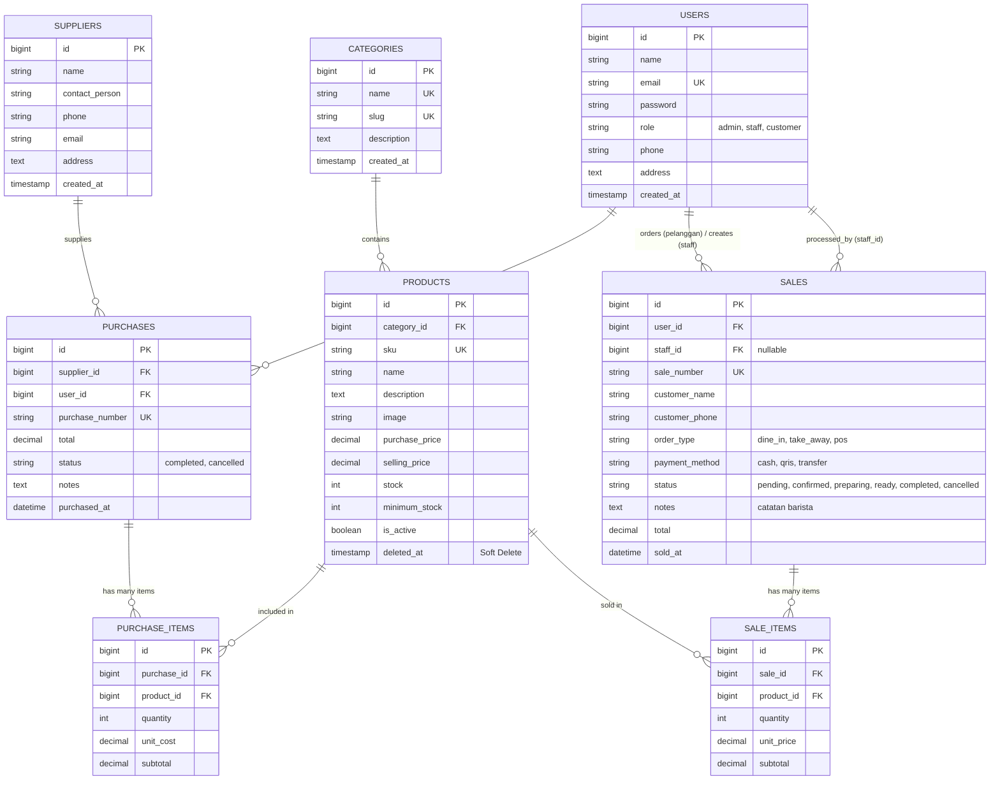

# KOPI SENJA — Coffee Shop & Pastry Management System
> *Tagline: “Temukan Cerita di Setiap Tegukan.”*

Aplikasi web terintegrasi berbasis **Laravel 12** dan **MySQL** yang dirancang dengan estetika modern coffee shop (*warm espresso, cream, beige, soft dark*), responsif di segala perangkat, dan mengimplementasikan arsitektur MVC, Eloquent ORM, transaksi database atomik (`DB::transaction`), row-locking (`lockForUpdate`), serta kontrol akses ketat untuk **3 Role Pengguna: ADMIN, STAFF, dan PELANGGAN**.

---

## 1. Project Overview & Business Domain

Aplikasi ini memecahkan permasalahan pencatatan manual pada rantai pasok dan operasional kedai kopi:
1. **Konsistensi Stok Fisik**: Setiap transaksi pembelian (*stock-in*) dari supplier menambah stok secara atomik. Setiap penjualan kasir POS walk-in maupun checkout pesanan online pelanggan mengurangi stok seketika.
2. **Pencegahan Overselling & Race Condition**: Menggunakan `Product::lockForUpdate()` dalam blok `DB::transaction()`. Jika stok produk tidak mencukupi, transaksi otomatis ditolak tanpa perubahan data (*rollback* utuh).
3. **Pemisahan Hak Akses (3 Roles)**:
   - **ADMIN (Pemilik / Pengelola)**: Memiliki akses penuh terhadap dashboard ringkasan eksekutif, master data produk (upload gambar, SKU unik), kategori, supplier (contact person), transaksi pembelian, seluruh penjualan, laporan keuangan dengan filter rentang tanggal, manajemen akun staff, dan pembatalan transaksi dengan pemulihan stok (*stock restore*).
   - **STAFF (Barista / Kasir)**: Mengelola operasional harian, melihat katalog & ketersediaan stok, memproses kasir POS walk-in, input pengadaan pembelian dari supplier, serta memproses antrean pesanan online pelanggan (*Menunggu Konfirmasi &rarr; Dikonfirmasi &rarr; Sedang Disiapkan &rarr; Siap Diambil &rarr; Selesai*).
   - **PELANGGAN (Customer Online)**: Mengakses landing page estetik, menjelajahi menu kopi & pastry, mencari & memfilter kategori, menambahkan menu ke keranjang belanja interaktif, melakukan checkout (pilihan *Dine In* / *Take Away*, nomor WhatsApp, catatan barista), memantau status pesanan aktif dengan live progress tracker, dan membatalkan pesanan sebelum disiapkan (*stok otomatis kembali*).

---

## 2. Tech Stack & Requirements

- **PHP**: `>= 8.2` (dengan ekstensi `pdo_mysql`, `mbstring`, `openssl`, `fileinfo`)
- **Framework**: **Laravel 12.x** (MVC Architecture, Eloquent ORM, Blade Templating)
- **Database**: **MySQL** / MariaDB (Port 3306, Database: `kopi_senja`)
- **Frontend & Styling**: Tailwind CSS, FontAwesome 6, Google Fonts Plus Jakarta Sans & Playfair Display
- **Testing**: PHPUnit 11.x (16 Automated Feature & Unit Tests, 48 Assertions)

---

## 3. Langkah Instalasi & Menjalankan Project

### Langkah 1: Clone atau Masuk ke Direktori Project
```bash
cd "C:\Users\MyBook Hype AMD\.gemini\antigravity\scratch\kopi-inventory-sales"
```

### Langkah 2: Konfigurasi Environment (`.env`)
Pastikan file `.env` telah menggunakan konfigurasi database MySQL:
```env
APP_NAME="KOPI SENJA"
APP_ENV=local
APP_KEY=base64:BixNc6cMHmUXFYr9fH+5P3BzkD5Goq3wWNuMeNOIMhc=
APP_DEBUG=true
APP_URL=http://localhost:8000

DB_CONNECTION=mysql
DB_HOST=127.0.0.1
DB_PORT=3306
DB_DATABASE=kopi_senja
DB_USERNAME=root
DB_PASSWORD=
```

### Langkah 3: Membuat Database MySQL & Menjalankan Migrasi
Pastikan service MySQL (XAMPP / Standalone) telah berjalan di port 3306, lalu jalankan:
```bash
# Buat database jika belum ada
mysql -u root -e "CREATE DATABASE IF NOT EXISTS kopi_senja CHARACTER SET utf8mb4 COLLATE utf8mb4_unicode_ci;"

# Jalankan migrasi dan seeder
php artisan migrate:fresh --seed
```

### Langkah 4: Hubungkan Storage untuk Gambar Upload
```bash
php artisan storage:link
```

### Langkah 5: Menjalankan Web Server Lokal
```bash
php artisan serve
```
Buka browser dan akses: **`http://127.0.0.1:8000`**

---

## 4. Akun Demo untuk Pengujian Lokal

Pada halaman login (`/login`) telah disediakan tombol **1-Click Quick Demo Login** untuk memudahkan dosen dan penguji beralih peran secara instan:

| Peran (Role) | Email Login | Kata Sandi | Halaman Utama Setelah Login |
| :--- | :--- | :--- | :--- |
| **ADMIN / OWNER** | `admin@kopi.com` | `password` | `/admin/dashboard` (Statistik, Master Data, Laporan, User) |
| **STAFF / BARISTA** | `staff@kopi.com` | `password` | `/staff/dashboard` (Antrean Pesanan Masuk, Kasir POS, PO Supplier) |
| **PELANGGAN / CUSTOMER** | `pelanggan@kopi.com` <br>*(atau `customer@kopi.com`)* | `password` | `/customer/dashboard` (Status Pesanan Aktif, Keranjang, Profil) |

*Catatan: Pendaftaran akun baru melalui `/register` secara otomatis dan wajib menghasilkan role PELANGGAN demi keamanan sistem.*

---

## 5. Entity Relationship Diagram (ERD) & Relasi Eloquent

### Mermaid ERD


### Penjelasan Relasi Eloquent
1. **`Category hasMany Products`** & **`Product belongsTo Category`**: Relasi *one-to-many* antara kategori menu dan produk. Listing produk selalu menggunakan Eager Loading `Product::with('category')->paginate(10)` untuk mengeliminasi masalah *N+1 query*.
2. **`Supplier hasMany Purchases`** & **`Purchase belongsTo Supplier`**: Setiap transaksi pengadaan (*stock-in*) terikat ke satu data supplier mitra kebun/bahan baku.
3. **`Purchase hasMany PurchaseItems`** & **`PurchaseItem belongsTo Purchase`**: Faktur pembelian memuat banyak baris detail barang.
4. **`Sale hasMany SaleItems`** & **`SaleItem belongsTo Sale`**: Nota penjualan memuat banyak rincian menu yang dipesan. Snapshot `unit_price` disimpan pada saat transaksi terjadi agar perubahan harga produk di masa depan tidak merusak laporan masa lalu.
5. **`Product hasMany PurchaseItems / SaleItems`**: Menjaga integritas data transaksi. Produk yang memiliki catatan transaksi dilindungi dari *hard delete* menggunakan Laravel `SoftDeletes`.

---

## 6. Business Logic & Konsistensi Stok (Wajib Benar)

1. **Atomisitas Transaksi (`DB::transaction`)**:
   Penyimpanan header transaksi, item detail, dan mutasi stok dibungkus dalam satu transaksi database. Apabila terjadi kegagalan validasi atau error sistem pada salah satu baris, seluruh perubahan otomatis di-*rollback* sehingga tidak ada data setengah tersimpan.
2. **Pencegahan Overselling & Row Locking (`lockForUpdate`)**:
   Saat penjualan atau checkout diproses, baris produk dikunci sementara menggunakan `$product = Product::lockForUpdate()->findOrFail(...)`. Hal ini mencegah dua pesanan bersamaan menjual sisa stok fisik yang sama (*race condition*).
3. **Kalkulasi Harga di Sisi Server (Backend)**:
   Total transaksi dan subtotal selalu dihitung dari harga jual asli yang tersimpan di database server (`$product->selling_price * $qty`). Sistem tidak mempercayai nilai harga maupun grand total yang dikirimkan melalui request browser client.
4. **Aturan Pembatalan Transaksi Konsisten**:
   - Jika transaksi penjualan dibatalkan oleh Admin atau oleh Pelanggan (sebelum disiapkan), sistem secara otomatis mengembalikan (*restore*) stok produk yang bersangkutan ke inventaris etalase.
   - Status transaksi diubah menjadi `cancelled`, dan pengecekan idempotent mencegah pembatalan ganda memulihkan stok berulang kali.
   - Jika transaksi pembelian dari supplier dibatalkan, stok dikurangi kembali dengan validasi agar stok produk tidak bernilai negatif.

---

## 7. Panduan Pertanyaan Code Ownership Interview (Slide 24)

Berikut ringkasan jawaban teknis terstruktur untuk sesi wawancara kepemilikan kode:

1. **Mengapa `Sale` memiliki relasi `hasMany` ke `SaleItem`?**  
   *Jawaban*: Karena satu transaksi nota kasir (*one header*) dapat memuat lebih dari satu jenis menu kopi atau pastry (*many items*). Menyimpan detail pada tabel `sale_items` memungkinkan pencatatan kuantitas dan harga satuan pada saat transaksi terjadi (*snapshot price*).
2. **Di mana sistem memastikan stok tidak menjadi negatif?**  
   *Jawaban*: Pada `SaleController::store()` dan `CartController::processCheckout()` sebelum pengurangan stok dilakukan:
   ```php
   if ($qty < 1 || $product->stock < $qty) {
       throw ValidationException::withMessages([
           'items' => "Kuantitas tidak valid atau stok tidak mencukupi untuk '{$product->name}'. Tersedia: {$product->stock}, Diminta: {$qty}.",
       ]);
   }
   ```
3. **Mengapa total penjualan dihitung di server?**  
   *Jawaban*: Untuk keamanan data (*Security*). Jika total dihitung di browser, pihak tak bertanggung jawab dapat memanipulasi request HTTP (misal via DevTools atau Postman) untuk mengubah total tagihan menjadi Rp 1. Dengan menghitung total di server: `$subtotal = $product->selling_price * $qty; $total += $subtotal;`, manipulasi harga mustahil terjadi.
4. **Apa risiko jika pengurangan stok dilakukan di luar `DB::transaction`?**  
   *Jawaban*: Terjadi *data inconsistency*. Jika header penjualan berhasil disimpan, tetapi koneksi database terputus saat memotong stok pada item kedua, maka uang tercatat masuk namun data stok gudang tidak terpotong (data korup).
5. **Bagaimana mencegah Staff mengakses fungsi Admin melalui URL langsung?**  
   *Jawaban*: Melalui middleware otorisasi server-side `CheckRole` yang didaftarkan di `bootstrap/app.php` dan diaplikasikan pada grup route di `routes/web.php` menggunakan `Route::middleware('role:admin')`. Menyembunyikan tombol di UI saja tidak cukup; server akan memblokir request langsung dengan respon `HTTP 403 Forbidden`.
6. **Apa yang terjadi jika dua penjualan memproses stok produk yang sama hampir bersamaan?**  
   *Jawaban*: Penggunaan `Product::lockForUpdate()` menahan *pessimistic row-level lock* pada baris database produk tersebut selama transaksi berlangsung. Transaksi kedua akan mengantre hingga transaksi pertama selesai, sehingga sisa stok diperiksa ulang dan mencegah *overselling*.
7. **Tunjukkan validasi SKU unik dan jelaskan peran constraint database.**  
   *Jawaban*: Validasi di controller menggunakan `'sku' => ['required', 'string', 'max:50', 'unique:products,sku']`. Di database migration ditambahkan `$table->string('sku', 50)->unique();`. Constraint database bertindak sebagai benteng pertahanan terakhir yang menjamin tidak akan ada SKU duplikat meskipun terjadi *bypass* validasi form.
8. **Ubah aturan minimum stock dan tunjukkan dampaknya.**  
   *Jawaban*: Aturan minimum stock menentukan kapan sebuah produk masuk ke dalam scope `Product::scopeLowStock()` (`whereColumn('stock', '<=', 'minimum_stock')`). Jika minimum stock dinaikkan, produk terkait akan langsung memicu alert warna merah/kuning di Dashboard Admin, Dashboard Staff, dan Banner Peringatan Restock.

---

## 8. Bukti Hasil Pengujian Otomatis (Automated Testing Proof)

Semua skenario pengujian fungsional dan keamanan berhasil lulus **100% (16 Passed, 48 Assertions)**:
```bash
php artisan test
```

### Cuplikan Output Pengujian
```text
   PASS  Tests\Unit\ExampleTest
  ✓ that true is true

   PASS  Tests\Feature\CoffeeInventoryTest
  ✓ guest cannot access dashboard and wrong password rejected
  ✓ registration always creates customer role even if role submitted
  ✓ customer cannot access staff or admin dashboard
  ✓ staff cannot access admin user management or cancel routes
  ✓ duplicate sku and negative price are rejected
  ✓ successful purchase increments stock properly
  ✓ successful sale decrements stock properly
  ✓ sale with insufficient stock is rejected without data change
  ✓ transaction atomicity rollbacks entirely when one item fails
  ✓ customer can add to cart and checkout successfully
  ✓ customer cannot view other customer orders
  ✓ staff can update order status
  ✓ cancellation restores stock and prevents double restoration
  ✓ search and filter yield matching results

   PASS  Tests\Feature\ExampleTest
  ✓ the application returns a successful response

  Tests:    16 passed (48 assertions)
  Duration: 4.13s
```

---

## 9. Batasan Sistem (Known Limitations)

- Sistem pembayaran online (QRIS dan Transfer Bank) menggunakan metode verifikasi kasir internal simulasi dan belum terhubung ke vendor payment gateway pihak ketiga seperti Midtrans/Xendit (sesuai batasan PPT Slide 4: *"Tidak diwajibkan: Payment gateway nyata"*).
- Dirancang khusus untuk pengelolaan single-outlet coffee shop & roastery warehouse (tidak memerlukan multi-warehouse logistik kompleks).
